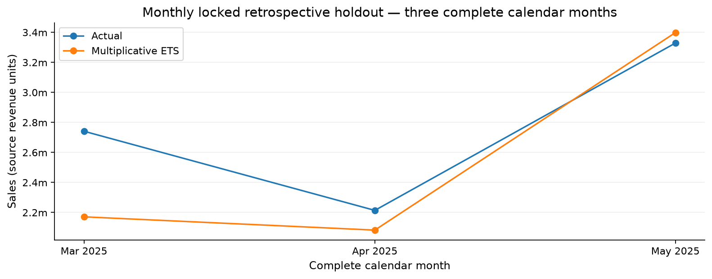

# Sales Forecasting

## Overview

This project analyzes historical sales transactions to forecast weekly and monthly revenue. It combines data preparation, exploratory analysis, time-series construction, model comparison, and retrospective forecast evaluation.

The analysis uses Python to investigate how recorded sales change over time and how forecasting performance differs across horizons.

## Project Objective

The objective is to develop and evaluate forecasts for 13 complete weeks and three complete calendar months, while accounting for seasonality, data quality, and the order in which observations become available.

## Skills Demonstrated

- Data Cleaning and Dataset Integration
- Exploratory Data Analysis (EDA)
- Time-Series Preparation
- Seasonality Analysis
- Chronological Model Validation
- Forecast Evaluation and Visualization

## Tools and Technologies

- Python 3.14
- pandas, NumPy, and openpyxl
- Prophet and statsmodels
- scikit-learn, XGBoost, LightGBM, and CatBoost for study comparisons
- Matplotlib
- Jupyter and joblib

## Dataset

The original Excel workbook contains 60,097 sales lines and product, region, and salesperson lookup sheets. Recorded sales cover July 2021 through May 2025; the revenue currency is unspecified.

The workbook and processed datasets are excluded. The `data/` directory retains instructions and `raw/` and `processed/` placeholders. No verified public download URL or redistribution license accompanies the workbook. See [data instructions](data/README.md).

The original Prophet and ETS files are also excluded because their serialized contents contain observed sales history. Parameter recipes and aggregate results are included.

## Key Analysis Performed

### Data Preparation and Integration

Reviewed missing values and order identifiers, then joined sales with descriptive lookup tables.

### Sales Pattern Analysis

Examined sales over time, category and regional contributions, and the unusual recording pattern in 2022.

### Time-Series Construction

Aggregated daily revenue into complete Sunday-to-Saturday weeks and calendar months. Excluded incomplete boundary periods.

### Forecast Model Comparison

Compared candidate methods using chronological development folds and earlier inner folds for parameter selection. The selected weekly model is multiplicative Prophet; the monthly model is ETS with additive trend and multiplicative seasonality.

### Retrospective Evaluation

Reported WAPE, MAE, RMSE, bias, and other diagnostics on the locked retrospective evaluation periods.

## Results

| Forecast | Evaluation horizon | Retrospective WAPE |
| --- | --- | ---: |
| Weekly Prophet | 13 weeks | 23.87% |
| Monthly ETS | 3 months | 9.31% |

WAPE expresses total absolute error relative to total actual sales; it is not an accuracy percentage. Weekly and monthly scores describe different aggregation levels and horizons. These previously examined periods are retrospective evaluations, not new independent tests. See the [weekly](tables/weekly_retrospective_results.csv) and [monthly](tables/monthly_retrospective_results.csv) result tables.

## Example Visualizations

The project includes historical sales plots, category and regional summaries, model comparisons, retrospective forecasts, and forecasts anchored to the historical cutoff.



## Installation

Clone the repository and create an environment using Python 3.14:

```bash
git clone https://github.com/staticbloom/sales-forecasting.git
cd sales-forecasting
python3.14 -m venv .venv
```

Activate the environment on macOS/Linux:

```bash
source .venv/bin/activate
```

On Windows, create the environment with `py -3.14 -m venv .venv` and activate it in PowerShell:

```powershell
.venv\Scripts\Activate.ps1
```

Install the recorded dependencies:

```bash
python -m pip install -r requirements.txt
python -m pip check
```

The version pins match the recorded project environment. Installation in a fresh environment has not been independently verified.

## Usage

### Review the saved analysis

Open [the notebook](notebook/Sales-Data.ipynb) on GitHub to read its saved results. Running the original analysis requires the excluded workbook.

### Train on an authorized new sales series

```bash
python train.py new_daily_sales.csv --frequency monthly --output-dir runs/monthly_candidate
python predict.py --frequency monthly --model runs/monthly_candidate/monthly_ets.joblib --periods 3 --output outputs/monthly_predictions.csv
```

The CSV must contain exactly `Date,Sales` in that order, with calendar dates and finite nonnegative amounts. Monthly training requires at least 27 complete months with positive period totals. Weekly training requires 117 complete weeks; use `--frequency weekly` and the resulting `weekly_prophet.json` file.

Missing days are rejected unless `--missing-days zero` is explicitly selected. The fixed recipe is evaluated before a full-history refit is exported. Use a new output directory and prediction filename.

**The default original-model prediction commands will not work in a fresh clone.** Supply `--model` as above, or restore matching authorized artifacts. The full original-study rebuild is documented in [technical notes](TECHNICAL_NOTES.md); it requires the workbook and replaces generated study outputs.

## Limitations and Reproducibility

- The original source and serialized models are intentionally absent; a fresh clone cannot reproduce the complete historical study by itself.
- Recorded gaps do not prove zero demand. Unusual recording patterns, unspecified currency, and unobserved business drivers limit interpretation.
- Forecasts from the original study begin after May 2025. Longer requested horizons do not update the model or establish new validation.

See [technical notes](TECHNICAL_NOTES.md) for the complete input contract, detailed workflow, and reproduction limits. Model artifacts should only be loaded from trusted sources.

## Author

**Shiv Sharma**

Data Analyst working with Python, statistical analysis, data visualization, and machine learning.
